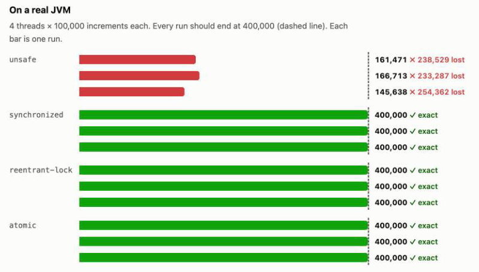
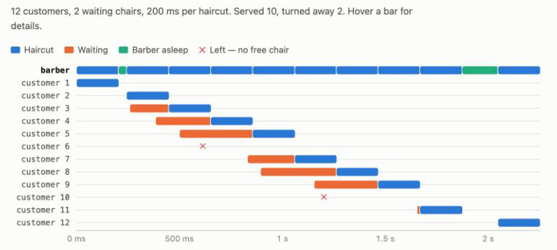

# Concurrency Lab

[](https://github.com/andreanicte02/concurrency-lab/actions/workflows/ci.yml)
[](https://github.com/andreanicte02/concurrency-lab/releases/latest)
[](https://andreanicte02.github.io/concurrency-lab/)

*[Leer en español](#en-español)*

Three classic Java concurrency bugs — **reproduced on a real JVM, then fixed** — with tests that
prove the fixes and an interactive site that shows the results.

**▶ See it live: <https://andreanicte02.github.io/concurrency-lab/>**

| Problem | The bug | The fix |
|---|---|---|
| **Lost update** | `count = count + 1` from several threads loses increments | `synchronized`, `ReentrantLock`, `AtomicLong` |
| **Overdrawn account** | check-then-act: two ATMs see the same money and both pay it out | make check + update one atomic step |
| **Sleeping barber** | busy-waiting, lost wake-ups, unbounded waiting room | bounded `BlockingQueue`: `offer()` claims a chair, the barber sleeps in `take()` |

## What it looks like

Four threads add 100,000 each; the unsafe counter loses more than half of the updates, every
fixed version lands exactly on 400,000:

[](https://andreanicte02.github.io/concurrency-lab/#counter)

A real run of the sleeping barber — haircuts, waiting customers, the barber asleep, and
customers who left because every chair was taken:

[](https://andreanicte02.github.io/concurrency-lab/#barber)

The site also has a step-by-step walkthrough where **you** play the thread scheduler and can
cause (or prevent, with a lock) the lost update yourself.

## How the site gets real numbers

```
 push to main / weekly cron
          │
          ▼
 GitHub Actions ──► mvn package ──► java -jar concurrency-lab.jar all --json ──► results.json
                                                                                     │
 GitHub Pages ◄──────────────────── web/ (index.html + app.js + results.json) ◄──────┘
```

Nothing on the charts is simulated: the experiments run on a GitHub-hosted JVM at deploy time,
and the page reads the JSON they produce. The environment (Java version, OS, CPU count) and
timestamp are shown at the top of the site. Results differ between runs — that's the point.

## Run it

Download `concurrency-lab.jar` from the [latest release](https://github.com/andreanicte02/concurrency-lab/releases/latest) (Java 21+):

```console
$ java -jar concurrency-lab.jar counter

COUNTER  4 threads x 100,000 increments = 400,000 expected

  implementation         actual         lost     time
  unsafe                195,649      204,351     14ms  RACE
  unsafe                167,358      232,642      2ms  RACE
  unsafe                119,531      280,469      1ms  RACE
  synchronized          400,000            0     14ms  ok
  ...
```

```sh
java -jar concurrency-lab.jar counter --threads 8 --increments 1000000
java -jar concurrency-lab.jar bank --customers 16 --balance 5000
java -jar concurrency-lab.jar barber --chairs 3 --haircut-ms 500
java -jar concurrency-lab.jar all --json
```

Or build from source:

```sh
mvn verify                                   # compile + run the tests
java -jar target/concurrency-lab.jar all
```

To preview the site locally:

```sh
java -jar target/concurrency-lab.jar all --json > web/results.json
python3 -m http.server --directory web
```

## Project layout

```
src/main/java/.../counter/   Counter implementations + experiment runner
src/main/java/.../bank/      Account implementations + ATM experiment
src/main/java/.../barber/    Sleeping barber with BlockingQueue + virtual-thread customers
src/main/java/.../Main.java  CLI (table or --json output)
src/test/java/...            JUnit 6 tests for every fix and invariant
web/                         Static site deployed to GitHub Pages
```

## What the tests check

- Thread-safe counters never lose an update (8 threads × 50,000, repeated).
- The unsafe counter can lose updates but never invents them.
- The synchronized account pays out exactly its balance — never more — and ends at 0.
- The barber cuts one customer at a time, only customers who sat down, the waiting room never
  exceeds its chairs, every customer is either served or turned away, and an idle barber
  sleeps instead of spinning.

## Background

This started in 2020 as three university exercises in Java threads (a shared counter, an ATM
and the sleeping barber). The original barber busy-waited with `while (true);` and could miss
wake-ups. It was rewritten in 2026 with Java 21, side-by-side broken/fixed versions, tests,
CI and the live site. The original code is in the [first commit](https://github.com/andreanicte02/concurrency-lab/tree/d6977c7).

---

## En español

**Concurrency Lab** muestra tres errores clásicos de concurrencia en Java. Cada uno se
**reproduce en una JVM real y luego se corrige**:

1. **Actualización perdida:** varios hilos hacen `count = count + 1` y se pierden incrementos.
   Se corrige con `synchronized`, `ReentrantLock` o `AtomicLong`.
2. **Cuenta sobregirada:** dos cajeros revisan el saldo al mismo tiempo, ven el mismo dinero y
   los dos lo entregan. Se corrige haciendo que revisar y restar sea un solo paso atómico.
3. **Barbero dormilón:** un barbero, sillas de espera limitadas y clientes que llegan. Se
   resuelve con una `BlockingQueue`: sin espera activa y sin señales perdidas.

En la [página en vivo](https://andreanicte02.github.io/concurrency-lab/) puedes jugar a ser el
planificador de hilos y provocar el error por tu cuenta, y ver los resultados reales que GitHub
Actions genera cada vez que se publica (y cada semana).

Para correrlo: descarga el `.jar` de [Releases](https://github.com/andreanicte02/concurrency-lab/releases/latest)
y ejecuta `java -jar concurrency-lab.jar all` (requiere Java 21+).

Empezó en 2020 como ejercicios de la universidad sobre hilos en Java y se reescribió en 2026.

## License

[MIT](LICENSE)
